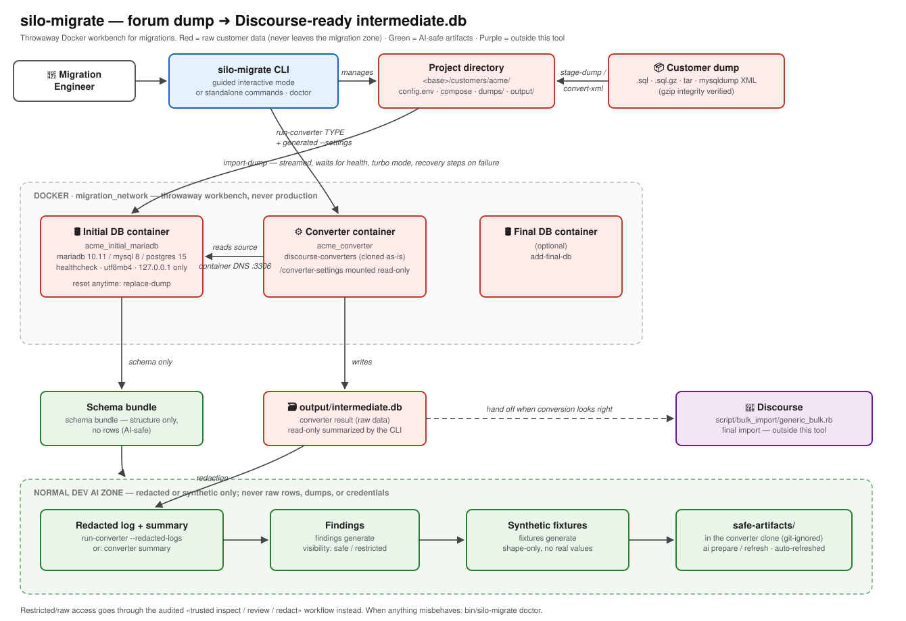
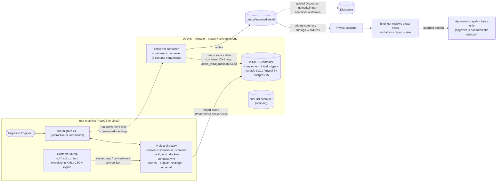
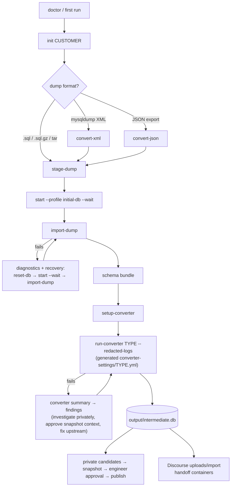
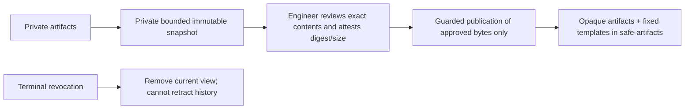

# silo-migrate — Migration Engineer's Guide

A practical overview of what the tool does, what it deliberately does not do, and
the two ways to drive it (guided interactive mode and standalone commands).
For internals and design rationale, see [`ARCHITECTURE.md`](../ARCHITECTURE.md).

> **Historical visual:** [`migration-overview.svg`](migration-overview.svg)
> predates exact-byte release approval. Do not use its artifact/data-safety
> arrows as current operating guidance; the approval diagrams below supersede them.



## What this tool is

`silo-migrate` turns a customer's raw forum database dump into a Discourse-ready
intermediate database, using **throwaway Docker containers** as the workbench.
You point it at a dump; it provisions a source database container, restores the
dump into it, runs the matching `discourse-converters` converter against that
database over a private Docker network, and collects the converter's output
(`output/intermediate.db`) plus private candidate artifacts (schema bundles,
redacted logs, findings and synthetic fixtures). Only separately reviewed exact
snapshots can enter the generated development context.

It can also configure scratch Discourse uploads/import containers for the final
handoff: the uploads container produces `output/uploads.sqlite3`, and the import
container runs Discourse's `generic_bulk.rb` against `output/intermediate.db`
and optionally that uploads database.

Nothing it creates is production infrastructure. Every container exists only to
host data long enough for conversion and can be destroyed and rebuilt from the
dump at any time.

## How everything is connected



Key wiring facts:

- **Containers talk over `migration_network`** using container names as DNS
  hostnames (`acme_initial_mariadb:3306`). Your host reaches the same databases
  on `127.0.0.1:<mapped port>` (see each phase's `dumps/<phase>/CONNECTION.md`).
- **`run-converter CUSTOMER TYPE` generates `converter-settings/TYPE.yml`**
  automatically — the platform's default settings with the real container
  hostname, internal port, and credentials merged in — and passes it via
  `--settings`. Without this, converter defaults point at `localhost` and cannot
  reach the database from inside the container.
- **Everything is rebuildable**: `reset-db` archives private source derivatives and wipes one database volume so you
  can re-import; it does not archive/withdraw/revoke the separate approved view,
  and prints a reminder to review releases and explicitly revoke obsolete snapshots; `cleanup` removes the whole project (it refuses to delete the
  directory if containers could not be stopped, unless you pass `--force`).

## What the tool CAN do

| Area | Capabilities |
|------|--------------|
| Environment | `doctor` preflight (Ruby, gems, Docker daemon, Compose v2, git, base path, free disk); first-run prompt picks and persists where projects live |
| Projects | `init` / `list` / `status` / `regenerate` / `cleanup`; per-customer `config.env` compatible with the legacy Python toolkit layout |
| Dumps | Stage `.sql`, `.sql.gz`, tar archives containing SQL; mysqldump **XML → SQL** conversion (`convert-xml`, streaming, batched INSERTs); generic **JSON → SQL** conversion (`convert-json`, streaming relational shredding, NDJSON pagination support, optional `--schema-dir` JSON Schemas for exact types + PII tracking, `--recover-truncated` for cut-off files); `analyze-dump` (tables, sizes, source engine); `preprocess-dump` (MySQL generated-column fixes); gzip integrity verification before import |
| Databases | MariaDB 10.11, MySQL 8.0, PostgreSQL 15 containers with healthchecks, utf8mb4 defaults, and import-friendly InnoDB settings; optional separate **final** database |
| Import | Streamed restore (constant memory, progress + ETA), waits for container health, MySQL-8-collation auto-fix on MariaDB, table exclusion, `--fast`/`--turbo` modes, per-error diagnostics with exact recovery commands |
| Converter | Clones/builds `discourse-converters` in its own container; platform shortcut (`run-converter acme vbulletin`) with auto-generated in-network settings, or any custom command after `--` |
| Discourse handoff | Configures two scratch Discourse containers (`uploads` and `import`), prepares role-specific dependencies, runs the uploads importer, restores a backup to the import container, runs `generic_bulk.rb`, and copies out a final backup |
| Artifacts | Schema bundles (`schema bundle`), redacted converter logs/summaries, structured findings, shape-only synthetic fixtures, approval-gated snapshot publication in `safe-artifacts/` (`release prepare/approve/publish/revoke`; no producer auto-refresh) |
| Data safety | Exact-byte engineer approval gates the generated context view; labels/redaction are not approval. Caller authentication, OS/provider isolation and legacy inspect/session error-path hardening remain separate requirements |

## What the tool CANNOT do (by design)

- **It does not create production Discourse infrastructure.** The Discourse
  uploads/import containers are local scratch handoff containers. They are meant
  to run upload import, restore, generic import, and final backup steps, not to
  host a live site.
- **It does not host production databases.** Containers bind to `127.0.0.1`,
  use root credentials from `config.env`, and trade durability for import speed
  (`innodb-doublewrite=0` etc.). Treat them as scratch space.
- **It does not provision SQL Server.** Platforms whose converters connect to
  SQL Server (e.g. `forza`, `higher_logic`) are detected and rejected with
  guidance — bring your own database and pass `--settings` manually.
- **It does not modify `discourse-converters`.** The converter repo is cloned
  and orchestrated as-is; converter bugs are fixed upstream, aided by the
  findings/fixtures artifacts this tool produces.
- **No incremental imports.** A dump is restored whole. Every import performs a
  live empty-database check; retry only after `reset-db CUSTOMER PHASE --yes`.
- **Docker is the only active runtime.** The Silo/Incus runtime is a Phase-4
  placeholder behind the same contract; Podman is best-effort, untested.
- **Real customer data never becomes a fixture.** Fixtures are shape-only and
  synthetic; anything containing raw values stays in the migration runtime zone
  or behind the `trusted` workflow.

## Happy path — interactive mode

Run `bin/silo-migrate` (or `bin/silo-migrate acme`). Guided mode is a persistent,
state-aware dashboard with a recommendation and blocked-action reasons. It shows:
`Initial dump`, `Final dump`, `Converter setup`, `Discourse uploads container`,
and `Discourse import container`. Each workflow previews what it will do, then
chains the existing setup/start/import/bundle steps with explicit back/cancel
points:

1. **First run only** — prompted for a base path (default `~/migrations/customers`),
   persisted to `~/.config/silo-migrate/config.env`. Warned early if Docker is down.
2. **Select or create the project** — pick from existing projects or name a new
   one; choose the initial DB type (mariadb/mysql/postgres) and port.
3. **Add the initial dump** — choose SQL dump, tar archive, XML dumps, or JSON
   export files (XML/JSON are converted to `.sql.gz` on the spot, with
   file-exclusion and batch-size prompts; JSON also auto-detects a `schema/`
   directory of `*.schema.json` files for exact column types and PII tracking,
   and offers record-level recovery when a file is truncated).
   Path input has tab completion; `back`/`b`/`..` returns to the menu.
4. **Start initial DB and import** — confirms the target, starts the container,
   waits for health, offers large-table exclusions and turbo mode (recommended
   for >1 GB), streams the import with progress, and writes an
   `.imported.json` marker. A schema bundle is generated automatically after.
5. **Add final database** (optional) — same flow for the target-side DB.
6. **Converter setup** — clones `discourse-converters` (with SSH passphrase
   retry if needed), builds the container, runs `bundle install`.
7. **Run converter command** from `Converter actions` — runs the converter; on completion you are offered
   the chain: redacted summary → findings → synthetic fixtures, each defaulting
   to yes.
8. **Discourse uploads container** — configures Discourse container files,
   rebuilds/starts a vanilla Discourse uploads container, then stops before the
   uploads importer if `output/intermediate.db` is missing. Once converter
   output exists, it prepares dependencies and runs the upload importer.
9. **Discourse import container** — configures Discourse container files,
   rebuilds/starts a vanilla Discourse import container, then shows an explicit
   action menu. Restore, backup, and status are available immediately; importing
   `intermediate.db` or running uploads+import appears once converter output
   exists. Import actions prepare dependencies immediately before running
   `generic_bulk.rb`.
10. **Advanced actions** are grouped by area: initial dump/database, final
    dump/database, conversion, converter, Discourse uploads, Discourse import,
    and project/service actions.

## Happy path — CLI command mode

The same flow as explicit, repeatable commands (what you'd put in a runbook):

```bash
# 0. one-time machine setup
bin/silo-migrate doctor

# 1. create the project (mariadb is the usual source engine)
bin/silo-migrate init acme --db-type mariadb

# 2. stage the customer dump (sql, sql.gz, or tar containing sql)
bin/silo-migrate stage-dump acme initial /path/to/forum-dump.sql.gz
#    ...or convert mysqldump XML straight into the project:
bin/silo-migrate convert-xml /path/to/xml-dir -c acme --compress
#    ...or convert JSON export files (schemas optional; see help convert-json):
bin/silo-migrate convert-json /path/to/json-dir -c acme --schema-dir /path/to/schemas

# 3. start the source DB and restore the dump into it
bin/silo-migrate start acme --profile initial-db --wait
bin/silo-migrate import-dump acme initial --turbo

# 4. capture the AI-safe schema bundle
bin/silo-migrate schema bundle acme

# 5. set up and run the converter (settings are generated automatically)
bin/silo-migrate setup-converter acme --bundle-install
bin/silo-migrate run-converter acme vbulletin --redacted-logs

# 6. produce private candidates, then review exact snapshots before publishing
bin/silo-migrate findings generate acme
bin/silo-migrate fixtures generate acme
bin/silo-migrate release prepare acme schema/initial/summary.json --class summary
# Privately inspect .silo-migrate/releases/snapshots/ARTIFACT_ID.bin.
# Replace placeholders with its actual ID, digest and byte count, then attest:
bin/silo-migrate release approve acme ARTIFACT_ID --sha256 DIGEST --bytes BYTE_COUNT --reviewed --reviewer engineer
bin/silo-migrate release publish acme ARTIFACT_ID
# ai prepare/refresh are guarded publication aliases, never implicit approvals.

# 7. optional Discourse handoff containers
# one-time Linux launcher checkout setup; skip if /var/discourse already exists
bin/silo-migrate discourse install-launcher

bin/silo-migrate discourse setup acme
bin/silo-migrate discourse rebuild acme --role uploads
bin/silo-migrate discourse start acme --role uploads
bin/silo-migrate discourse prepare-deps acme --role uploads
bin/silo-migrate discourse run-uploads acme
bin/silo-migrate discourse rebuild acme --role import
bin/silo-migrate discourse start acme --role import
bin/silo-migrate discourse prepare-deps acme --role import
bin/silo-migrate discourse restore-import acme --backup /path/to/backup.tar.gz
bin/silo-migrate discourse import acme
bin/silo-migrate discourse backup-import acme

# done? park or remove the workbench
bin/silo-migrate stop acme
bin/silo-migrate cleanup acme --yes
```

Useful variations:

```bash
bin/silo-migrate help import-dump                      # every flag, per command
bin/silo-migrate analyze-dump dump.sql.gz              # what's in this dump?
bin/silo-migrate run-converter acme -- ./convert --from vbulletin --settings /converter-settings/vbulletin.yml
bin/silo-migrate reset-db acme initial --yes           # archive derivatives, reset DB
bin/silo-migrate history list acme                     # inspect retained archives
bin/silo-migrate converter source acme final           # persist cutover source
bin/silo-migrate converter output-db acme output/custom.db
bin/silo-migrate converter summary acme                # re-summarize without re-running
```

## The pipeline at a glance (states and recovery)



## Data-safety zones (what AI tooling may see)

Keep the converter checkout clean: source code and synthetic tests only, never
raw dumps, generated settings, customer decisions or data-bearing logs. A path,
model preference, generated instruction or read-only convention is not an OS
sandbox. The currently generated view does not configure Silo/Claude mounts,
credentials, network policy or provider isolation.

All schema, logs, summaries, findings and synthetic fixtures are **private
candidates**. Neither `safe`, metadata-only, regex redaction nor a previous
manifest authorizes publication. `release prepare` snapshots bounded exact bytes
privately; the engineer inspects those contents and approves the ID, digest and
byte count with `--reviewed`. Only approved snapshots can be published. SHA-256
proves byte identity, not that the bytes are safe. Do not send private snapshots
to coding providers for a safety judgment.



`ai prepare/refresh` explicitly publish approved snapshots; producer hooks no
longer refresh anything. Without approvals the view is empty. Fixed instructions
are generated only inside `safe-artifacts/`; there are no new root `AGENTS.md`,
`.claude` deny settings, Silo snippets or Git exclude rewrites. Original names,
customer identity, reviewer and notes do not enter generated metadata.

Revocation records the terminal decision before inspecting/withdrawing a corrupt
or interrupted view. Status also withdraws stale/legacy context under absent or
blocked state. If cleanup/storage fails, the command fails and reports blocked
state, not successful revocation. Source resets do not revoke independent
snapshots: explicitly revoke a snapshot when its context is no longer intended.
Publication views are no longer moved into workflow history outside the release
lock. Private source/history/snapshot retention is not data deletion or recall.

Legacy root files generated by earlier versions may contain customer identifiers
and stale instructions/deny rules. They are not rewritten automatically: the
engineer must review/retire them privately before exposing a checkout. Existing
operator-owned/upstream files are preserved. Never assume a root instruction or
`safe-artifacts/` path itself makes data safe.

See the README's engineer-reviewed publication contract for limits, failure
recovery, retained snapshots and filesystem assumptions. This synthetic local
slice does not approve customer use; known inspect/session raw-byte and parser
privacy risks and runtime/provider isolation must be addressed first.

## Quick troubleshooting

| Symptom | Do this |
|---------|---------|
| Anything feels broken | `bin/silo-migrate doctor` |
| Import failed mid-way | The phase is `dirty`; run `reset-db CUSTOMER PHASE --yes`, then start and import again |
| "gzip integrity check failed" | The dump is truncated — re-transfer it (don't bypass unless you're certain) |
| "Malformed JSON in FILE … appears to be truncated" | The JSON export was cut off. Re-export it for the full data; meanwhile `--recover-truncated` (or the guided-mode prompt) keeps the complete records and reports recovered counts, or skip the file with `-X FILE` |
| Paginated JSON export imports only one page | The file may be NDJSON. `convert-json` auto-detects seekable NDJSON; pass `--ndjson` explicitly for `.json.gz` NDJSON or when you want to force one JSON document per line |
| JSON tables/columns look unexpected | Conventions: nested objects flatten (`avatar.url` → `avatar_url`); arrays become `<table>_<path>` child tables joined via `_parent_id` (natural key) or `_parent_sid`; deep/mixed shapes land in `*_json` TEXT columns. See "JSON-to-SQL Conversion Design" in the workspace ARCHITECTURE.md |
| Converter can't reach the DB | Use the platform shortcut so settings are generated; if compose was regenerated, recreate the container: `start CUSTOMER --profile converter` |
| Port already in use | Default ports auto-advance to the next free port (the chosen port is printed); an explicit `--port` fails fast with a free-port suggestion |
| Huge dump is slow on a Mac | Expected (Docker Desktop fsync); the preflight warns. Prefer a Linux host for multi-GB imports |
| Want a clean slate | `reset-db CUSTOMER PHASE --yes` (one DB, private source derivatives archived; approved view/snapshots require explicit revocation) or `cleanup CUSTOMER --yes` (everything — **push converter work first**, the clone lives inside the project dir) |
| `safe-artifacts/` shows in `git status` | Its own generated `.gitignore` ignores new contents. Investigate previously tracked files privately; publication no longer rewrites Git excludes |
| Legacy root `AGENTS.md` / Claude or Silo snippets | Review/retire stale generated files privately; new fixed instructions live only inside the view. Do not overwrite upstream/operator files or infer isolation from old deny rules |
